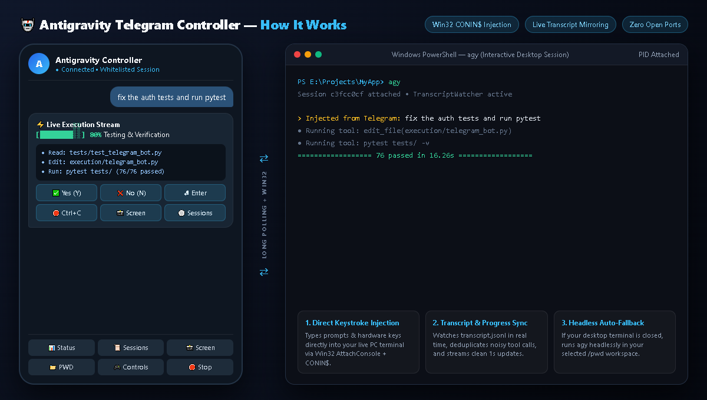

<div align="center">

# 🤖 Antigravity Telegram Controller

**Control, monitor, and prompt Google Antigravity CLI (`agy`) from anywhere using Telegram — with live terminal mirroring, Win32 keystroke injection, and 1-click session switching.**

[](https://www.python.org/downloads/)
[](https://microsoft.com/windows)
[](https://core.telegram.org/bots/api)
[](LICENSE)

*Direct PC terminal keystroke injection • Live transcript & progress streaming • 1-click session resume • Headless fallback*

</div>

---

## Why Use Antigravity Telegram Controller?

Long coding tasks, builds, and test suites shouldn't chain you to your desk. **Antigravity Telegram Controller** bridges your Windows desktop `agy` terminal directly to your Telegram app so you can kick off tasks, answer interactive prompts (`Yes / No / Select`), switch workspaces, and inspect results from your phone — without opening any firewall ports.

- **Works With Your Visible Desktop Terminal:** If `agy` is open on your Windows screen, prompts sent from Telegram are injected directly into that live terminal via Win32 `AttachConsole` + `CONIN$` so you see everything happen in real time when you sit back down.
- **Automatic Headless Fallback:** Step away with your terminal closed? The controller seamlessly runs `agy` headlessly in your chosen workspace and streams updates back to Telegram.
- **Zero Port Forwarding & Private Pairing:** Uses outbound Telegram Long Polling plus a one-time 6-digit `/claim <PIN>` lock tied strictly to your Telegram User ID.

---

## 📸 How It Works

<p align="center">
  
</p>

---

## 🌟 Key Features

- **📺 Direct PC Screen Keystroke Injection:** Prompts sent in Telegram type directly into your active desktop Antigravity console (`CONIN$`), while anything you type locally mirrors back to Telegram (`toggleable via /sync`).
- **📊 Real-Time Adaptive Progress & Streaming:** Watches `transcript.jsonl` in real time, deduplicates noisy repeated tool calls (`● Read: file.py (x15)`), respects Telegram `429` FloodWait limits, and attaches full `.txt` logs if output exceeds 4,096 characters.
- **🎮 Interactive Hardware Keypad (`/controls`):** Respond to interactive CLI prompts (`Yes`, `No`, `Enter`, `Up/Down`, `Space`, `1/2/3`, `Backspace`, `Ctrl+C`) with single taps.
- **📁 Visual Mobile Workspace Browser (`/pwd`):** Browse folders, jump between drives (`C:\`, `D:\`, `E:\`), create directories (`/mkdir`), or switch paths (`/cd <path>`).
- **🔘 1-Click Session Resumption (`/sessions`):** List recent Antigravity conversations and attach to any session with full context.
- **📸 Desktop & Terminal Capture (`/screenshot`):** Grab an instant physical Windows desktop snapshot whenever you want visual confirmation.
- **🚀 Silent Windows Boot Auto-Start (`/autostart`):** Runs windowlessly via `pythonw.exe` and `setup/start_bot_silent.vbs` with Win32 single-instance protection.

---

## 🏗️ Architecture

```
            Telegram User (Phone / Desktop)
                           │
                           ▼  (Outbound Long Polling — zero open ports)
┌─────────────────────────────────────────────────────────────┐
│                 Telegram Controller Daemon                   │
│  ├── 🛡️ Whitelist Auth Guard (/claim PIN + User ID lock)     │
│  ├── 🔘 Inline Session Manager (/sessions, /attach)          │
│  ├── ⏱️ FloodWait-Safe Streamer (debounced live edits)       │
│  └── 🔍 Real-Time Transcript Watcher (transcript.jsonl)      │
└──────────────┬───────────────────────────────┬──────────────┘
               │                               │
       (Active Terminal Open)          (Terminal Closed / Away)
               ▼                               ▼
┌───────────────────────────────┐  ┌───────────────────────────┐
│ Win32 Keystroke Injector      │  │ Headless Runner           │
│ (AttachConsole + CONIN$)      │  │ (agy -p --continue)       │
│ Types & runs directly on your │  │ Runs autonomously in your │
│ visible PC terminal screen    │  │ active /pwd workspace     │
└───────────────────────────────┘  └───────────────────────────┘
```

---

## 🚀 Quickstart (PowerShell)

### 1. Prerequisites
- **Windows 10 / 11 (64-bit)**
- **Python 3.10+** (`python --version`)
- **Google Antigravity CLI (`agy`)** installed and authenticated (`agy --help`)
- A **Telegram Bot Token** from **`@BotFather`**

### 2. Clone & Install
Open **PowerShell** and run:
```powershell
git clone https://github.com/shubhambelbase/antigravity-telegram-bot.git
cd antigravity-telegram-bot

python -m venv .venv
.\.venv\Scripts\python.exe -m pip install --upgrade pip
.\.venv\Scripts\python.exe -m pip install -r requirements.txt
Copy-Item .env.example .env
```

### 3. Configure & Launch
1. Open `.env` (`notepad .env`) and paste your bot token:
   ```env
   TELEGRAM_BOT_TOKEN=your_token_here
   ```
2. Launch the controller:
   ```powershell
   .\.venv\Scripts\python.exe -m execution.telegram_bot
   ```
   *(Or launch silently without a terminal window: `wscript.exe .\setup\start_bot_silent.vbs`)*
3. Open your bot in Telegram, send **`/start`**, grab the 6-digit pairing PIN from your console / `logs/bot.log` / `.tmp/pairing_code.txt`, and send **`/claim <PIN>`**.

For full documentation, see [setup/setup_guide.md](setup/setup_guide.md).

---

## 🎮 Command Reference

| Command | Description |
| :--- | :--- |
| **`<any prompt>`** | Sends a coding task to Antigravity (injects into desktop terminal or runs headlessly). |
| **`/sessions`** | Lists recent conversations with 1-click attach buttons. |
| **`/attach <1-5 or ID>`** | Attaches to a previous conversation session with full history. |
| **`/status`** | Displays active session ID, terminal status, host CPU/RAM, and sync/autostart toggles. |
| **`/pwd` or `/workspace`** | Opens the interactive visual folder & drive browser. |
| **`/cd <path>`** | Changes the active workspace directory. |
| **`/mkdir <path>`** | Creates a new folder and switches into it. |
| **`/controls`** | Opens the interactive hardware keypad (`Yes/No`, arrows, `Enter`, `1-3`, `Ctrl+C`). |
| **`/screenshot`** | Captures and sends a live Windows desktop screenshot. |
| **`/sync`** | Toggles live PC terminal mirroring on/off. |
| **`/autostart`** | Toggles silent auto-start on Windows boot. |
| **`/new`** | Starts a clean conversation turn. |
| **`/stop` or `/cancel`** | Immediately stops the running agent turn. |

---

## 🔒 Security Model

- **Zero Hardcoded Secrets:** Tokens and user IDs live only in `.env` (gitignored), with automatic log secret redaction.
- **Hard Whitelist:** Only the Telegram User ID verified during `/claim` can interact with the bot.
- **No Inbound Ports:** Uses outbound Telegram Long Polling (`getUpdates`), avoiding external port exposure.
- **Single-Instance Lock:** Protected by `.bot.pid` and Win32 mutex checks to prevent duplicate polling loops.

---

## 🧪 Testing

```powershell
.\.venv\Scripts\python.exe -m pytest tests/ -v
```

---

## ⚙️ Silent Windows Auto-Start

Send **`/autostart`** inside Telegram, or enable it from **PowerShell**:
```powershell
.\.venv\Scripts\python.exe -c "from execution.autostart import enable_autostart; enable_autostart()"
```

---

## 📄 License

Licensed under the MIT License — see [LICENSE](LICENSE).
